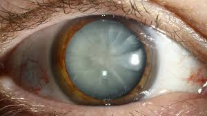
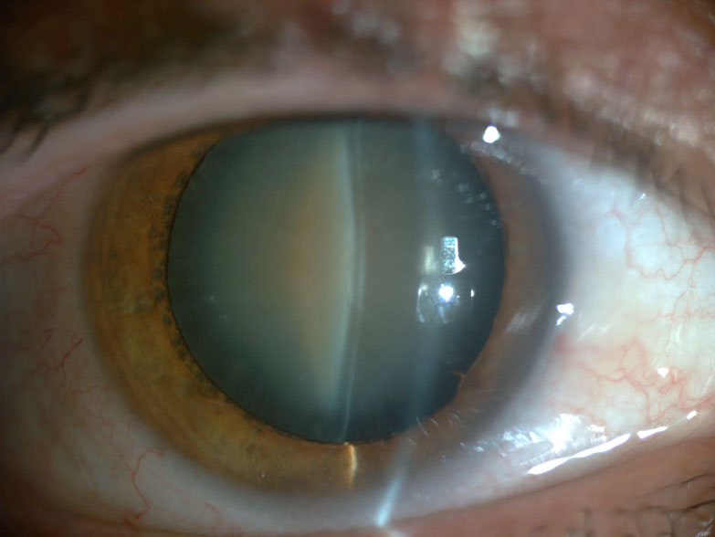

# Cataract Detection System


## 🔍 Overview

The **Cataract Detection System** is a deep learning-powered web application designed to detect and classify cataracts from eye images. This system uses an EfficientNetB0 model trained on eye fundus images to provide accurate Detection for cataract detection, helping healthcare professionals make informed decisions.

## ✨ Features

- **AI-Powered Detection**: Utilizes EfficientNetB0 deep learning model for accurate cataract Detection
- **User Authentication**: Separate registration and login for patients and medical staff
- **Image Upload**: Easy-to-use interface for uploading eye images
- **Real-time Detections**: Instant analysis and classification results
- **Dashboard Interface**: Clean and intuitive dashboard for viewing results
- **Responsive Design**: Works seamlessly across different devices

## 🛠️ Technology Stack

### Backend
- **Python 3.x**: Core programming language
- **Flask**: Web framework
- **TensorFlow/Keras**: Deep learning framework
- **EfficientNetB0**: Pre-trained model architecture

### Frontend
- **HTML5**: Structure
- **CSS3**: Styling
- **JavaScript**: Interactive functionality
- **Bootstrap** (implied): Responsive design

### Database
- **SQLite/MySQL**: User credentials and data storage

### Model
- **EfficientNetB0**: Transfer learning model
- **Model Size**: 47.8 MB
- **Format**: HDF5 (.h5)

## 📁 Project Structure

```
Cataract-Detection-system/
│
├── .vscode/                    # VS Code configuration
├── model/                      # Trained model directory
│   └── efficientnet_b0_model.h5
├── static/                     # Static files (CSS, JS, Images)
│   ├── auth.js
│   ├── BabyYodaGroguGIF.gif
│   ├── eye.png
│   ├── style.css
│   └── user_cred.sql
├── templates/                  # HTML templates
│   ├── dashboard.html
│   ├── index.html
│   ├── login.html
│   ├── signup_patient.html
│   └── signup_staff.html
├── uploads/                    # User uploaded images
│   ├── download.jpg
│   ├── image_2.jpeg
│   └── image3-1.png
├── venv/                       # Virtual environment
│   ├── Include/
│   ├── Lib/
│   └── Scripts/
├── .gitignore                  # Git ignore file
├── app.py                      # Main Flask application
├── demo.py                     # Demo/testing script
├── LICENSE                     # License file
├── README.md                   # Project documentation
└── requirements.txt            # Python dependencies
```

## 🚀 Installation

### Prerequisites
- Python 3.7 or higher
- pip (Python package installer)
- Virtual environment (recommended)

### Step-by-Step Installation

1. **Clone the repository**
```bash
git clone https://github.com/yourusername/Cataract-Detection-system.git
cd Cataract-Detection-system
```

2. **Create a virtual environment**
```bash
# Windows
python -m venv venv
venv\Scripts\activate

# macOS/Linux
python3 -m venv venv
source venv/bin/activate
```

3. **Install required packages**
```bash
pip install -r requirements.txt
```

4. **Set up the database**
```bash
# Initialize the database using the SQL file in static folder
# Or let the application create it automatically on first run
```

5. **Download the trained model**
- Ensure `efficientnet_b0_model.h5` is in the `model/` directory
- The model file should be approximately 47.8 MB

## 📋 Requirements

Based on the project structure, the key dependencies include:

```txt
Flask==2.3.0
tensorflow==2.13.0
keras==2.13.0
numpy==1.24.0
Pillow==10.0.0
werkzeug==2.3.0
opencv-python==4.8.0
scikit-learn==1.3.0
pandas==2.0.0
matplotlib==3.7.0
```

*Note: Check `requirements.txt` for the complete and exact version list*

## 🎯 Usage

### Running the Application

1. **Start the Flask server**
```bash
python app.py
```

2. **Access the application**
- Open your web browser
- Navigate to `http://localhost:5000` or `http://127.0.0.1:5000`

### User Workflow

1. **Registration**
   - Choose between Patient or Staff signup
   - Fill in required credentials
   - Create account

2. **Login**
   - Enter your credentials
   - Access the dashboard

3. **Upload Image**
   - Navigate to the Detection section
   - Upload an eye fundus image (JPG, JPEG, PNG)
   - Submit for analysis

4. **View Results**
   - See Detection results on the dashboard
   - View confidence scores
   - Download or save results

## 🧠 Model Details

### EfficientNetB0 Architecture

- **Base Model**: EfficientNetB0 (pre-trained on ImageNet)
- **Transfer Learning**: Fine-tuned for cataract detection
- **Input Size**: 224x224x3 (RGB images)
- **Output**: Binary or multi-class classification
- **Training Dataset**: Eye fundus images with cataract annotations

### Model Performance

The model has been trained to classify:
- Normal eye (no cataract)
- Cataract-affected eye
- Severity levels (if applicable)

*Expected accuracy metrics should be documented based on your validation results*

## 📊 Dataset

The system works with eye fundus images showing:
- Normal retinal images
- Images with various stages of cataract
- Different types of cataracts (cortical, nuclear, posterior subcapsular)

### Sample Images

The `uploads/` folder contains example images:
- `download.jpg`: Cataract example 1
- `image_2.jpeg`: Fundus image example
- `image3-1.png`: Cataract example 2

## 🔐 Security Features

- Password hashing for user credentials
- Session management for logged-in users
- Secure file upload validation
- SQL injection prevention
- CSRF protection

## 🎨 User Interface

### Pages

1. **Index Page** (`index.html`)
   - Landing page with system introduction
   - Quick access to login/signup

2. **Login Page** (`login.html`)
   - Secure authentication
   - Error handling

3. **Signup Pages**
   - `signup_patient.html`: Patient registration
   - `signup_staff.html`: Medical staff registration

4. **Dashboard** (`dashboard.html`)
   - Upload interface
   - Detection results
   - User profile management

## 🧪 Testing

Run the demo script to test model Detections:

```bash
python demo.py
```

This will test the model with sample images and display results.

## 🤝 Contributing

Contributions are welcome! Please follow these steps:

1. Fork the repository
2. Create a feature branch (`git checkout -b feature/AmazingFeature`)
3. Commit your changes (`git commit -m 'Add some AmazingFeature'`)
4. Push to the branch (`git push origin feature/AmazingFeature`)
5. Open a Pull Request

## 👥 Authors

- **Rohit Kumar** - [https://github.com/Rohit8024]
- **Ranjeet Kumbhar** - [https://github.com/RanjeetKumbhar01]

## 🙏 Acknowledgments

- EfficientNet model creators (Google Research)
- Medical datasets providers
- Open-source community
- Healthcare professionals for domain expertise

## 📚 References

- [EfficientNet Paper](https://arxiv.org/abs/1905.11946)
- [Flask Documentation](https://flask.palletsprojects.com/)
- [TensorFlow Documentation](https://www.tensorflow.org/)
- Medical literature on cataract detection

## 📱 Screenshots

### Upload Interface


### Detection Results


### Detection Example


---

**Note**: This is a medical assistance tool and should not replace professional medical diagnosis. Always consult with qualified healthcare professionals for medical decisions.

